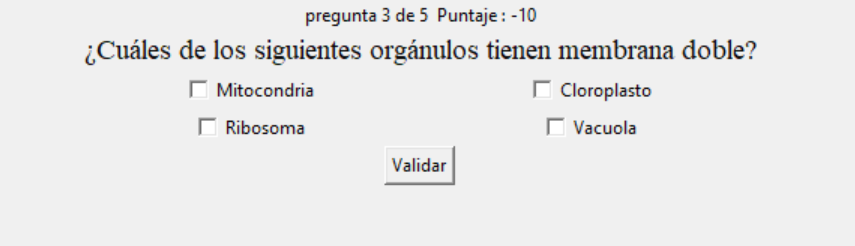

# Quiz de Biología Celular

Juego de preguntas de opción múltiple sobre orgánulos y estructuras celulares, hecho en Python con Tkinter. El jugador debe marcar **todas** las opciones correctas de cada pregunta.

## Cómo funciona
- El juego lee todas las preguntas del archivo `preguntas.JSON` y elige 5 al azar.
- Cada pregunta tiene 4 opciones (Checkbutton) y puede tener más de una respuesta correcta.
- Si las opciones marcadas son exactamente las correctas, suma **15 puntos**. Si falta o sobra alguna, resta **5 puntos**.
- Al terminar muestra el puntaje final y los aciertos y fallos.
- Si el archivo no existe, está mal escrito o tiene menos de 5 preguntas, muestra un mensaje de error.

## Requisitos
- Python 3
- Tkinter (viene incluido con Python)

## Cómo ejecutarlo
1. Descarga o clona este repositorio.
2. Deja `proyecto_biologia.py` y `preguntas.JSON` en la misma carpeta.
3. Abre una terminal en esa carpeta y ejecuta: `python proyecto_biologia.py`
4. Escribe tu nombre, presiona **Iniciar** y contesta las 5 preguntas.

## Archivos
- `proyecto_biologia.py`: código del juego.
- `preguntas.JSON`: banco de preguntas.

## Captura de pantalla

## Autor
Alejandro Fabio Ramos Baez
